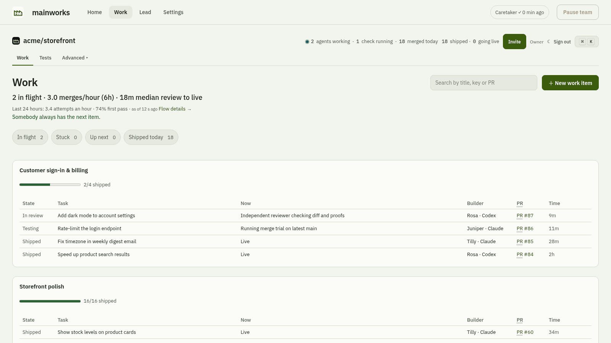
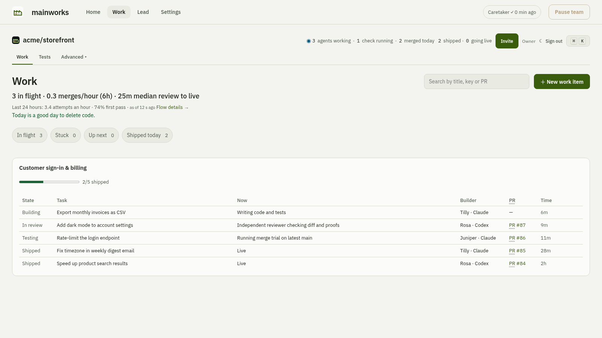
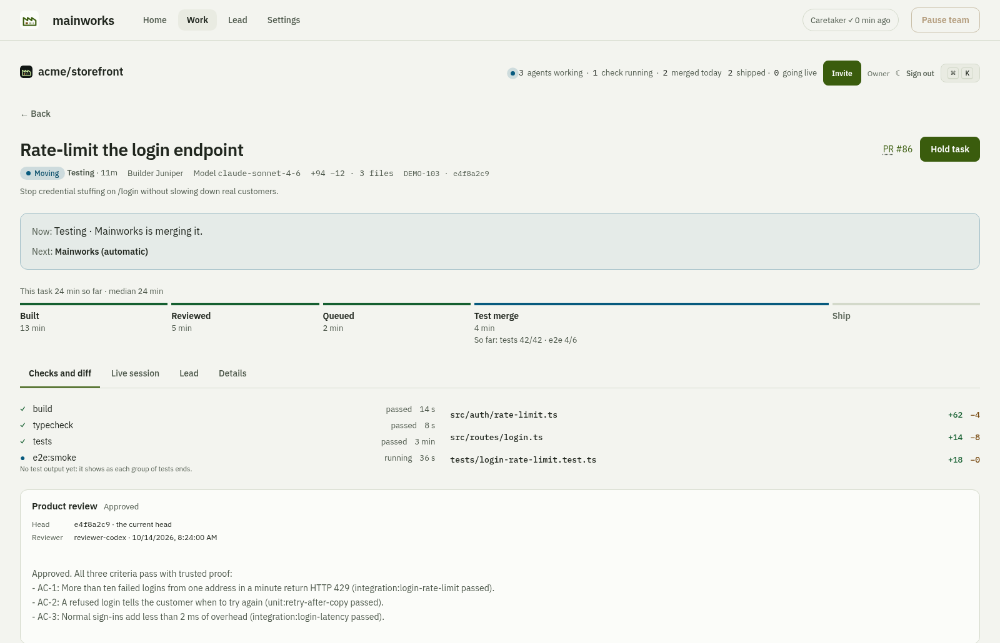
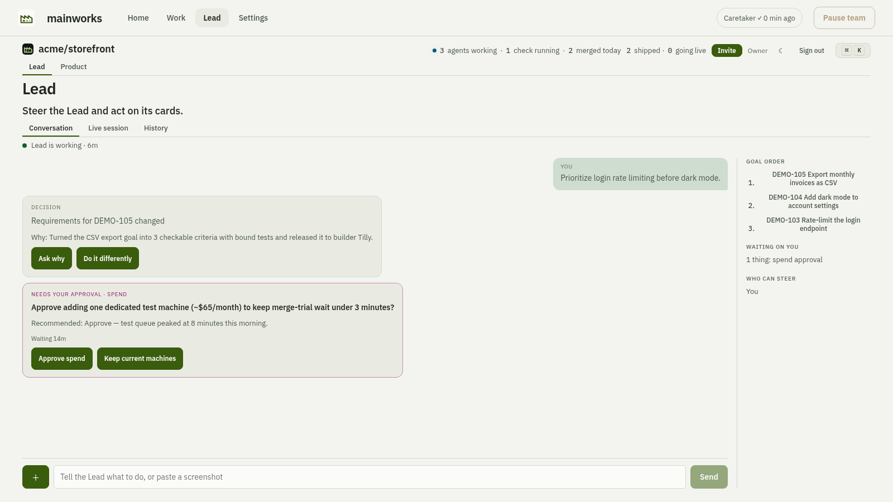

# Mainworks

**Give AI coding agents a goal. Get tested, reviewed, deployed code — on your own server.**

Mainworks is an open-source assembly line for software. You say what you want; agents like Claude Code, Codex and Gemini build it, a different agent reviews it, every change is tested against the latest code before it merges, and a bad release rolls itself back. You stay out of the loop except for the decisions that are really yours.

[](LICENSE) [](package.json)

[](docs/media/hero.mp4)

*One goal, start to live. No one touched the code in between.*

## Why this exists

Coding agents are good at writing code and bad at being trusted with it. Left alone they mark their own work as done, merge things that break each other, and leave you reviewing a pile of pull requests at midnight.

Mainworks is the part around the agent:

- **A second opinion on everything.** The agent that writes a change never approves it. A different one reads the diff and runs the proof.
- **Nothing merges untested.** Each change is tried on top of the latest main, on real test machines, before it lands.
- **Production protects itself.** Main deploys itself. If the release check fails, the change is reverted and reopened — automatically.
- **You decide what matters.** Goals, money, and who gets access. Everything else, the agents settle among themselves.

## What it looks like



**Work** shows every change and exactly where it is.



**Each change carries its own proof** — the requirement, the test that shows it, and who checked.



**Lead** tells you, in plain words, what happened and the few things that need you.

## How it works


1. **Goal** — you write what you want and why, in a sentence or two. A lead agent turns it into requirements that can be checked.
2. **Build** — a coding agent writes the change and its tests in a sandbox of its own.
3. **Review** — a different agent reads the diff and runs the proof for each requirement. It can send the work back.
4. **Merge trial** — the change is tested on top of the latest main. If main moved underneath it, it is tested again.
5. **Deploy** — main ships itself to your server.
6. **Watch** — a release that fails its check is rolled back and the change reopened.

## Try it

You need a Linux server with Docker, Git and Node 24, and an account with at least one coding agent (Claude Code, Codex or Gemini).

```sh
git clone https://github.com/cryptob1/mainworks.git && cd mainworks
npm ci && npm run build
node bin/mainworks.mjs up --repo OWNER/NAME
```

`up` prints a link. Open it, connect an agent account, and type your first goal.

Something missing on your machine? `mainworks doctor` names it and the command that fixes it. The full list is in the [setup guide](docs/setup.md).

## How fast is it?

Numbers from Mainworks building itself, in the week this was written:

| | |
|---|---|
| Changes merged per day | about 60 |
| Start to merged, typical | about 25 minutes |
| Merged on the first attempt | about 7 in 10 |
| Machines | one 24-core coordinator and two test machines |

These are our own measurements on our own repository, not a benchmark. Your project's tests decide your speed.

## What to run it on

**Use a dedicated server, not a shared virtual one.** Shared CPUs get throttled when neighbours are busy; one of our installs on a shared 8-core server regularly lost 60 to 75 percent of its CPU and was the bottleneck for days.

A good fit is a [Hetzner dedicated server](https://www.hetzner.com/dedicated-rootserver/) from the AX line with 64 GB RAM — roughly 50 to 110 US dollars a month; check the current price. (We have no affiliation with Hetzner.)

When tests become the limit, add another machine with one command:

```sh
mainworks host add you@other-machine
```

## Is it safe to let agents do this?

- Agents work in sandboxes and cannot push to main. Only the merge step can, and only after review and a passing trial.
- The agent that wrote a change cannot approve it or produce its proof.
- Your code and secrets stay on your server. The only outside parties are your Git host and the agent providers you connect.
- Every decision is recorded: who claimed, who reviewed, what was tested, what was reverted.

## Learn more

- [Setup guide](docs/setup.md) — requirements, first run, troubleshooting
- [How the parts fit together](docs/architecture.md) — for the curious: services, containers, where things run
- [Running several projects on one server](docs/shared-server.md)
- [Contributing](AGENTS.md) · [Apache 2.0](LICENSE)

Mainworks was previously called Graphyard; the `graphyard` command and settings still work.
