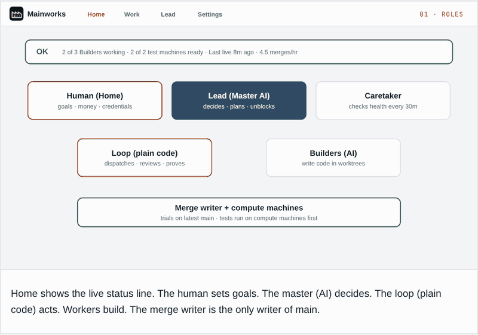
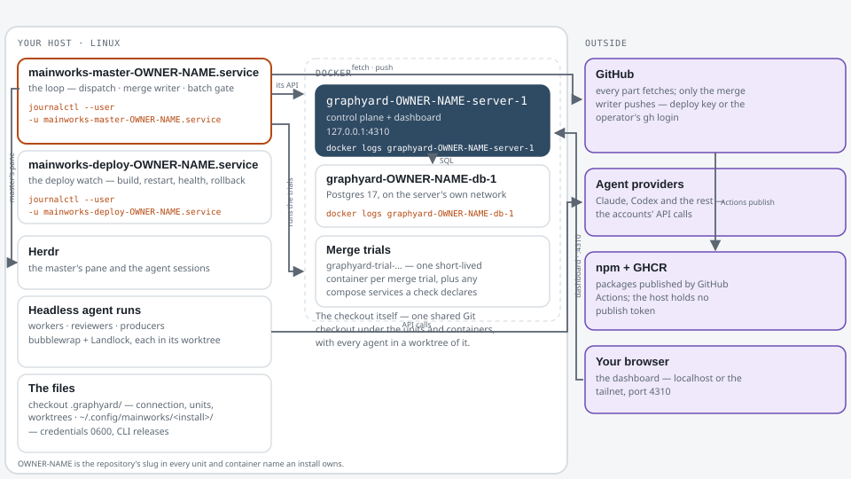

# Mainworks

**Open source, self-hosted software that lets AI coding agents like Claude Code, Codex and Gemini take your goals all the way to production, with independent review and proof.**

[](LICENSE) [](package.json)

[](docs/diagrams/how-mainworks-works.mp4)

## What Mainworks does

- You state a goal in plain words; a lead agent turns it into checkable criteria.
- Autonomous agents write the code in their own sandboxes, on your own server.
- A different agent does the code review, and checks the proof each criterion names.
- A merge queue tests each change on the latest main before it lands.
- Main deploys itself, and a failed release is reverted automatically.
- You keep three decisions: goals, money, and credentials for people.

## Quick start

```sh
git clone https://github.com/cryptob1/mainworks.git && cd mainworks
npm ci
npm run build
node bin/mainworks.mjs up --repo OWNER/NAME
```

Once published to npm:

```sh
npx @cryptob1/graphyard up --repo OWNER/NAME
```

Open the Setup link it prints and connect a worker and reviewer account. Click **New work item**, give it a title and optional description, and the master writes the criteria (**Advanced** shows the detail). Check on it with `mainworks master status`; update with `mainworks upgrade --plan`, then `mainworks upgrade`; diagnose with `mainworks doctor`.

Settings are `MAINWORKS_*` (`MAINWORKS_URL`). The `graphyard` command and `GRAPHYARD_*` settings still work.

## How it works

1. **Goal:** you write what you want and why.
2. **Build:** an agent writes the change and its tests.
3. **Independent review:** a second agent reads the diff and runs the proof.
4. **Merge trial:** the change is tested on top of the latest main.
5. **Deploy:** main ships itself to your server.
6. **Automatic revert:** a release that fails its check is rolled back.



`mainworks guide infra` lists every part.

## What you need

Use a dedicated server rather than a shared virtual one.
Shared CPUs get throttled: on one of our own shared servers, 70% CPU steal made the system kill the Mainworks loop twice mid-cycle.
A good fit is a [Hetzner dedicated server](https://www.hetzner.com/dedicated-rootserver/) from the AX line with 64 GB RAM.
It costs roughly 50 to 110 US dollars a month, check the current price.
Mainworks has no affiliation with Hetzner.
You can add more machines for tests later with one command: `mainworks host add`.

Prerequisites: Linux 7.0+ with Landlock ABI 9+ (`uname -r`; Ubuntu 26.04: `linux-image-oem-7.3`); Node 24+/npm (`node --version`, `npm --version`; Ubuntu/Debian: `curl -fsSL https://deb.nodesource.com/setup_24.x | sudo bash - && sudo apt install nodejs`, Arch: `sudo pacman -S nodejs npm`, macOS: `brew install node@24`); Git (`git --version`, `git remote -v`); Docker with Compose (`docker version`, `docker compose version`); GitHub CLI (`gh auth status`); bubblewrap (`bwrap --version`); Python (`python3 --version`); Herdr (`herdr --version`; install: `curl -fsSL https://herdr.dev/install.sh | sh`); systemd (`systemctl --user status`). An account for at least one agent: Claude Code, Codex or Gemini.

## Where to go next

- [Setup guide](docs/setup.md) and `mainworks guide setup` for every check and fix.
- [Shared server](docs/shared-server.md) to run several installs on one machine.
- `mainworks guide publishing`, `mainworks guide TOPIC` and `mainworks master guide` for the rest.
- [Re-render the walkthrough](docs/walkthrough.md), [Contributing](AGENTS.md), [Apache 2.0 license](LICENSE).
