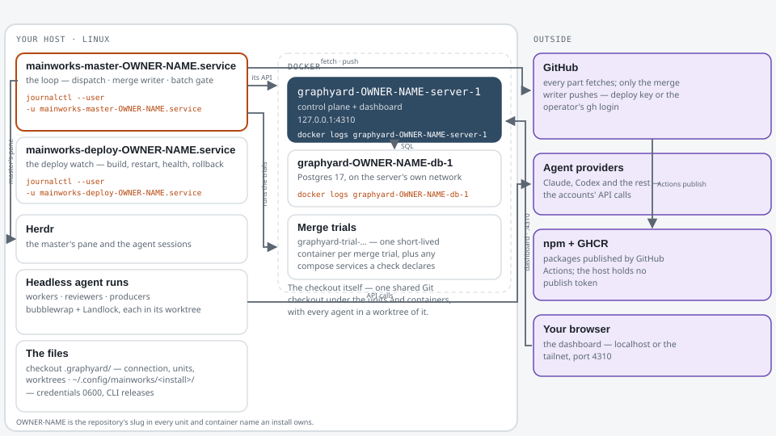

# How the parts fit together

Mainworks runs on a Linux coordinator host, with optional compute machines for running test shards.

On the coordinator, systemd user units run the orchestration loop (`graphyard-master-OWNER-NAME.service`) and the deploy watch (`graphyard-deploy-OWNER-NAME.service`), while Docker runs the control-plane server (`graphyard-OWNER-NAME-server-1`, port 4310) and Postgres (`graphyard-OWNER-NAME-db-1`). Herdr hosts the Lead's pane and live sessions, the caretaker checks accounts and stuck work every 30 minutes, and headless builder, reviewer and producer runs execute inside bubblewrap and Landlock sandboxes in their own worktrees.

When test shards run, compute machines take them first via rootless Docker, with the coordinator as fallback.

Run `mainworks guide infra` for the full table of units, containers, ports and log commands.
