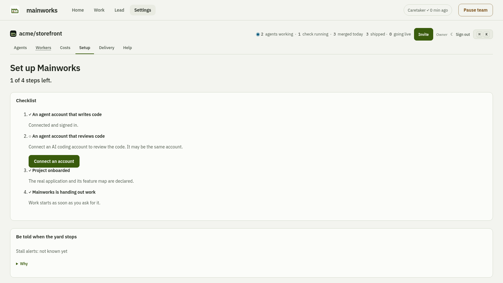
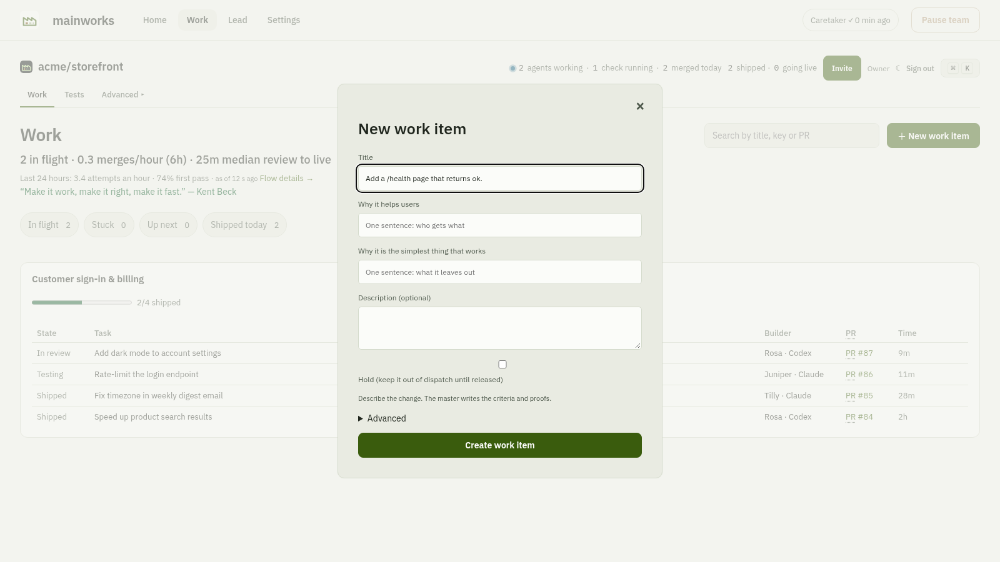

# Get started

This takes about fifteen minutes on a machine that already has Docker. By the end, an agent will have shipped one small change to your repository while you watched.

Stuck at any step? Run `mainworks doctor`. It checks everything on this page and prints the one command that fixes whatever is missing.

## 1. Check your machine

You need a Linux server you control. A laptop works for a first try; for real use see [what to run it on](../README.md#what-to-run-it-on).

| You need | Check it with |
|---|---|
| Linux with a recent kernel (7.0 or newer) | `uname -r` |
| Node 24 or newer | `node --version` |
| Git, and a repository on GitHub you can push to | `git --version` |
| Docker with Compose | `docker compose version` |
| The GitHub CLI, signed in | `gh auth status` |
| An account with a coding agent: Claude Code, Codex or Gemini | — |

A few smaller tools are needed too. Don't hunt for them: `mainworks doctor` lists exactly which are missing and how to install each on your system.

## 2. Install and start

```sh
git clone https://github.com/cryptob1/mainworks.git && cd mainworks
npm ci && npm run build
node bin/mainworks.mjs up --repo OWNER/NAME
```

Replace `OWNER/NAME` with your repository. `up` starts Mainworks and prints a **Setup link**. Open it.

## 3. Connect an agent



On the Setup page, connect one account for building and one for reviewing. They can be the same account. Wait for both to turn green.

## 4. Ship your first change



Click **New work item** and describe something small in a sentence, for example *"Add a /health page that returns ok."*

Then watch the **Work** page. You will see the change get written, reviewed by a second agent, tested on top of your main branch, and merged. A first change usually takes 20 to 40 minutes.

That's it. From here you give goals; Mainworks does the rest and asks you only about goals, money, and who gets access.

## Next steps

- **Make tests faster.** Add another machine for tests with one command: `mainworks host add you@other-machine`. It asks for that machine's sudo password once.
- **Tell Mainworks where your app runs,** so it can check each release and roll back a bad one: see [your app's address](reference.md#your-apps-address-and-live-deploys).
- **Invite a teammate** with the Invite button in the top bar.
- **Run several projects on one server:** see [shared server](shared-server.md).

## When something goes wrong

1. Run `mainworks doctor`. Most problems are a missing tool or a sign-in that expired, and it says which.
2. Open the **Lead** page. If Mainworks needs a decision from you, it is listed there in plain words.
3. Run `mainworks master status` for the full picture.

Everything else — resource sharing, test machines in depth, accounts, project configuration, publishing — is in the [reference](reference.md).

